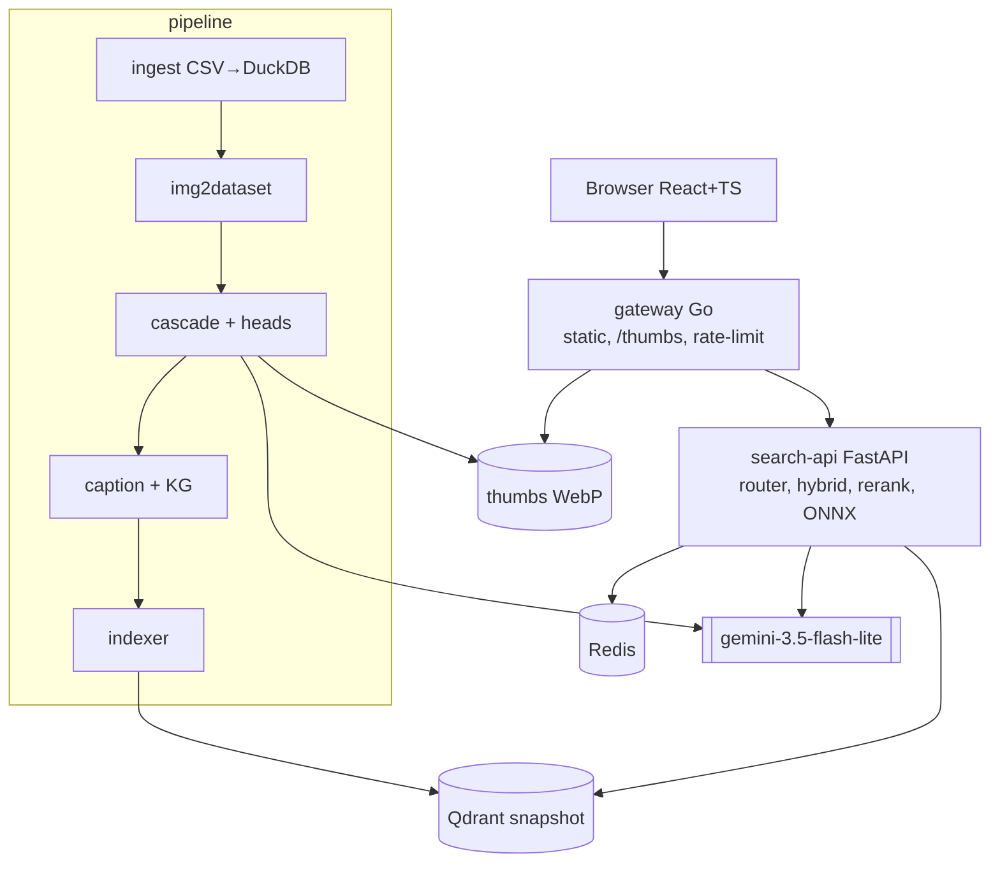

# VSF Capstone – Vietnamese Travel Image Moderation & Retrieval

Scalable image moderation and multimodal retrieval for Vietnamese travel photos: a **cascade "embed once, use many" filter** designed to scale to 10–100M images, and a **Vietnamese hybrid search** that answers single-intent, multi-intent and multi-hop queries in under 3 seconds.

> **Status: 🚧 design complete, implementation in progress.** Sections marked 🚧 describe planned behavior. Progress is tracked on the [project board](https://github.com/lecuong1502/VSF_Capstone_Image_Processing_and_Retrieval/projects) and in [milestones](https://github.com/lecuong1502/VSF_Capstone_Image_Processing_and_Retrieval/milestones).

## Table of contents

- [Problem](#problem)
- [Approach](#approach)
- [Architecture](#architecture)
- [Dataset](#dataset)
- [Tech stack](#tech-stack)
- [Quickstart](#quickstart)
- [Results](#results)
- [Roadmap](#roadmap)
- [Ethics & data policy](#ethics--data-policy)
- [Contributing](#contributing)
- [License & acknowledgements](#license--acknowledgements)

## Problem

**Part A – Filtering & moderation.** Tens of thousands of crawled images must be checked for relevance to their tourism entity (landmark, dish, craft village, …) and for unsafe or low-quality content (NSFW, watermarks, text overlays, political/violent content, poor quality). Reviewing every image with an LLM is too slow and too expensive at 10–100M images, and human reviewers often lack the domain knowledge to judge relevance.

**Part B – Retrieval.** Users search in Vietnamese with three kinds of queries, all within **p95 < 3 s**:

| Query type | Example | Difficulty |
|---|---|---|
| Single-intent | "bãi biển Nha Trang", "flycam vịnh Hạ Long" | Vietnamese text ↔ image matching |
| Multi-intent | "hồ bơi và công viên nước ở Phú Quốc" | split into sub-queries, guarantee coverage |
| Multi-hop | "nơi quay phim Kong ở Ninh Bình" | resolve a relation first, verified against a knowledge graph |
| Negative | people / places not in the collection | must correctly return nothing |

## Approach

**Part A – Cascade moderation.** Each image passes through cheap stages first; only the uncertain tail reaches the LLM:

1. **Metadata rules** – size, source, URL patterns.
2. **Download + dedup** – SHA-256 and PDQ perceptual hashes, plus embedding-based near-duplicate clustering.
3. **One embedding per image** (multilingual CLIP-style model on GPU) feeding many cheap **linear/MLP heads**: NSFW, watermark, text overlay, political, violence, quality, entity relevance, shot type. Heads are trained on the human `verify` labels plus Gemini labels (distillation); thresholds are chosen on PR curves.
4. **OCR / copy detection** (PaddleOCR, SSCD) only for the subset that needs it.
5. **`gemini-3.5-flash-lite`** (structured JSON output, Batch API) only for the ~2–5% borderline cases.

Estimated cost at 100M images: ≈ $0.9k–1.8k for the cascade vs. ≈ $23.5k–49k for calling Gemini on every image.

**Part B – Hybrid retrieval.** Qdrant stores three representations per accepted image: an image-dense vector, a text-dense vector (BGE-M3) over metadata + an offline Vietnamese caption, and a sparse BM25 vector with a Vietnamese tokenizer. Results are fused with RRF, reranked locally with `bge-reranker-v2-m3`, and diversified with MMR. A heuristic **query router** handles most queries; Gemini is called only when needed (1.2 s timeout, Redis cache) to classify, split multi-intent queries, or resolve multi-hop relations. Every LLM answer is **verified against a knowledge graph** built from the entity data.

## Architecture



Planned repository layout:

```text
apps/web/            React + Vite + TS UI (search grid, reasoning chain, /review tool)
services/gateway/    Go gateway (distroless)
services/search/     FastAPI search-api (router, hybrid, rerank, kg, llm)
pipeline/            ingest, download, hashing, embed, train_heads, ocr, sscd, gemini_label, caption, kg_build, decide, index
eval/                test set, judge, retrieval/moderation eval, bake-off
bench/ loadtest/k6/  benchmarks and load tests
deploy/              docker-compose, prometheus
docs/                architecture, performance, slides
data/sample/         small committed fixture for tests and CI
```

The full design document (Vietnamese) is in [`Thiết kế lọc, kiểm duyệt và truy xuất ảnh du lịch Việt Nam_ Cascade embedding và Hybrid Search.md`](<Thiết kế lọc, kiểm duyệt và truy xuất ảnh du lịch Việt Nam_ Cascade embedding và Hybrid Search.md>).

## Dataset

The dataset is built by merging six human-verified CSV exports of Vietnamese travel images collected from public web search results.

| | Count |
|---|---|
| Unique image URLs | **62,204** |
| Entities | 4,152 |
| Labeled (image, entity) pairs | 73,911 |
| Images labeled `verify = yes` (relevant) | ~27.7k |
| Image sources (domains) | 5,741 |
| Conflicting labels (excluded from training/eval) | 358 pairs |

Merge rules:

- Labels are keyed by **`(image_url, entity_id)`** – the same image can be relevant to one entity and irrelevant to another. The `images` table is deduplicated by URL.
- On conflicting labels, the more recently reviewed export wins; conflicting pairs are flagged and excluded from head training and evaluation until re-reviewed.
- Rows with an empty `verify` are kept as `unlabeled`: they are downloaded, embedded and indexed, but never used as ground truth.

> **The raw dataset is not distributed.** Only a small landmark-only fixture lives in [`data/sample/`](data/sample/). The pipeline reads raw CSVs from `RAW_DATA_DIR` (see `.env.example`). Contact the author for access.

## Tech stack

| Layer | Choice | Alternatives considered |
|---|---|---|
| Download | `img2dataset` → WebDataset | – |
| Dedup | SHA-256 + PDQ + embedding cosine | SSCD for copy detection |
| Image/text embedding | `jinaai/jina-clip-v2` (default), bake-off vs. `google/siglip2-base-patch16-256`, `google/siglip2-so400m-patch16-384` | `Qwen/Qwen3-VL-Embedding-2B` (optional upper bound) |
| Text embedding | `BAAI/bge-m3` + BM25 (Vietnamese tokenizer) | – |
| Reranker | `BAAI/bge-reranker-v2-m3` | `Qwen/Qwen3-VL-Reranker-2B` (offline) |
| OCR | PaddleOCR | – |
| LLM | `gemini-3.5-flash-lite` (the only LLM used) | – |
| Vector DB | Qdrant (dense + sparse, server-side RRF, snapshots) | FAISS, Milvus, pgvector |
| Metadata | DuckDB / Parquet (pipeline), SQLite read-only (serving) | Postgres at 100M scale |
| Backend | Go gateway + FastAPI + ONNX Runtime | Caddy, Triton |
| Frontend | React + Vite + TypeScript | Next.js |
| Cache | Redis | – |
| Eval / load test | `ranx`, k6 | Locust |
| CI/CD | GitHub Actions → GHCR | – |

Target hardware for development: a single NVIDIA RTX 4050 Laptop GPU (6 GB VRAM).

## Quickstart

> 🚧 Not runnable yet – these commands are being built in milestone `M0`.

```bash
git clone https://github.com/lecuong1502/VSF_Capstone_Image_Processing_and_Retrieval.git
cd VSF_Capstone_Image_Processing_and_Retrieval
cp .env.example .env              # set RAW_DATA_DIR, GEMINI_API_KEY, GEMINI_BUDGET_USD
make setup                        # install dependencies, download ONNX weights
make pipeline                     # ingest → download → moderate → caption → index
# or: make restore                # restore a Qdrant snapshot + thumbnails
docker compose -f deploy/docker-compose.yml up -d
open http://localhost:8080
```

Useful targets: `make lint test`, `make eval`, `make loadtest`.

## Results

> 🚧 Filled in as milestones complete. All numbers are measured on the full set of downloadable images from the 62,204 URLs.

**Moderation** (per head, 95% CI)

| Head | Precision | Recall | F1 |
|---|---|---|---|
| Relevance | TBD | TBD | TBD |
| NSFW / watermark / text / political / violence / quality | TBD | TBD | TBD |
| **Cascade – precision(pass)** (target ≥ 0.95) | TBD | | |
| **Escalation rate to Gemini** (target ≤ 5%) | TBD | | |

**Retrieval** (test set: 150 single, 100 multi-intent, 60 multi-hop, 30 negative queries)

| Query type | nDCG@10 | Recall@10 | MRR@10 | p95 latency |
|---|---|---|---|---|
| Single | TBD | TBD | TBD | TBD |
| Multi-intent | TBD | TBD | TBD | TBD |
| Multi-hop | TBD | TBD | TBD | TBD |
| Negative (correct empty) | TBD | | | TBD |

**Cost** (actual Gemini spend)

| Step | Tokens | USD |
|---|---|---|
| Moderation labels (5k images) | TBD | TBD |
| Borderline escalation | TBD | TBD |
| Captions | TBD | TBD |
| Eval judge | TBD | TBD |

## Roadmap

| Milestone | Scope |
|---|---|
| `M0 Foundation` | monorepo, Makefile, pre-commit, CI skeleton |
| `M1 Data` | ingest + merge, profiling, download, hashing/dedup, embeddings |
| `M2 Moderation` | `/review` tool, Gemini labels + audit, heads + calibration, OCR/SSCD, decision cascade, captions + KG |
| `M3 Retrieval & App` | Qdrant index, search-api (3 query paths), web UI, test set + eval + bake-off |
| `M4 Perf & Packaging` | k6 load tests + report, optimized Docker images, release to GHCR |
| `M5 Docs & Demo` | architecture & performance docs, slides |
| `Backlog` | public deployment, Qwen3-VL bake-off, other optional work |

See the [project board](https://github.com/lecuong1502/VSF_Capstone_Image_Processing_and_Retrieval/projects) for the current status of each issue.

## Ethics & data policy

- **Copyright.** Images remain the property of their original publishers. This repository distributes neither images, thumbnails, nor URL lists; the pipeline only processes them locally. To request removal of an image from any demo, open an issue or contact the author.
- **People in images.** The system uses face **detection** only (counting faces, face-area ratio, shot type). It performs **no face recognition** and stores **no face embeddings**. Queries about people are resolved through the knowledge graph and the entity labels, never by identifying faces; queries about private individuals are expected to return no results.
- **LLM use.** Gemini is used only for borderline moderation cases, offline captions, query understanding and evaluation judging. Its outputs are cached, budget-capped, and verified against the knowledge graph where they make factual claims.

## Contributing

See [CONTRIBUTING.md](CONTRIBUTING.md) and the [Code of Conduct](CODE_OF_CONDUCT.md). Report security issues as described in [SECURITY.md](SECURITY.md).

## License & acknowledgements

Licensed under the [Apache License 2.0](LICENSE).

Built as a capstone project for the VSF program. Thanks to the open-source projects this work relies on, including img2dataset, Qdrant, Jina AI, Google SigLIP, BAAI BGE, PaddleOCR, Meta PDQ/SSCD, LAION and k6.
