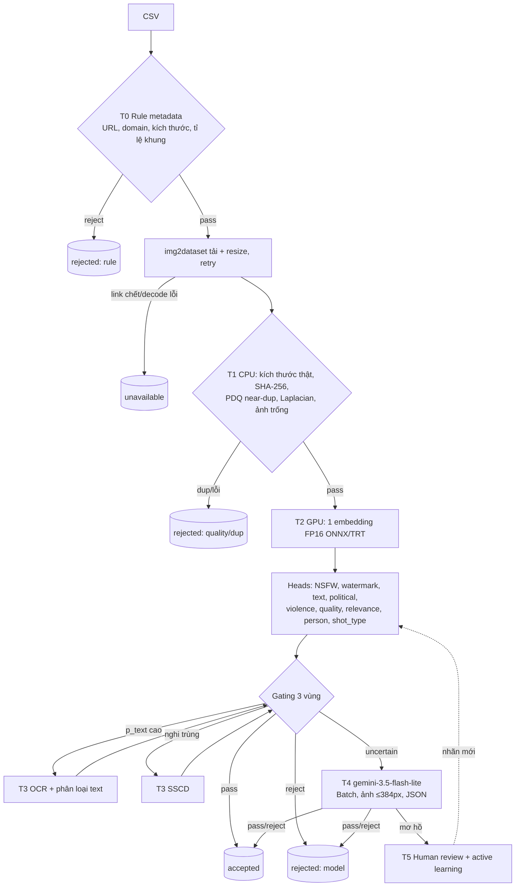
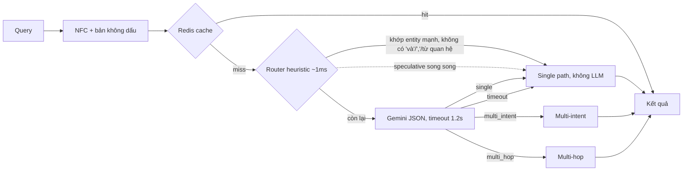
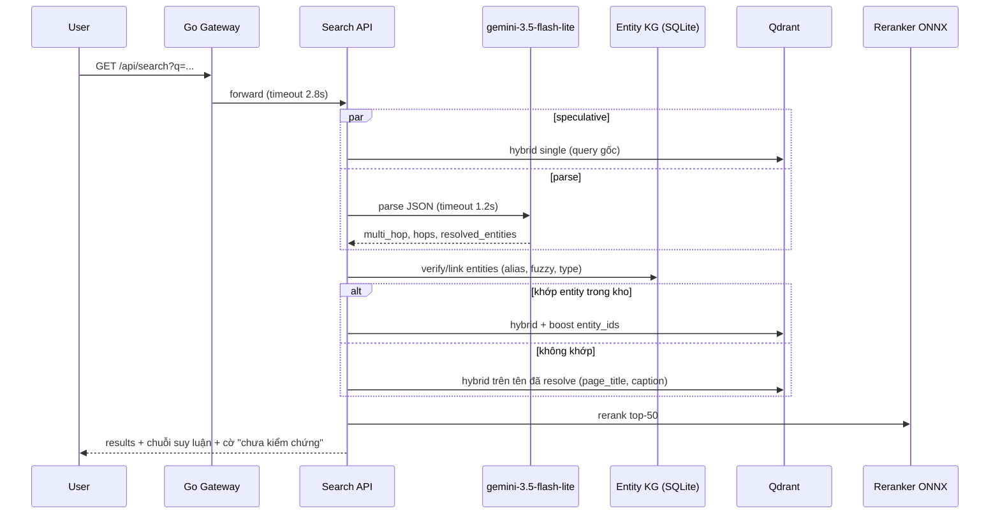
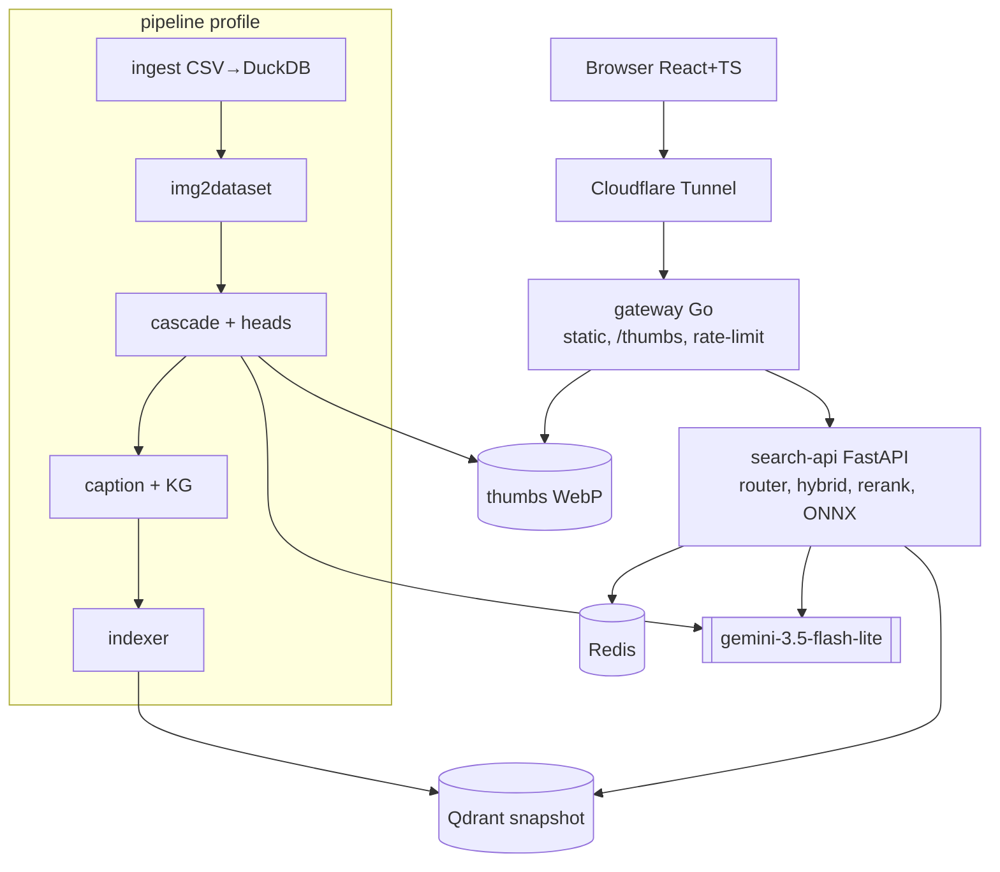

# Tài liệu thiết kế: Lọc/Kiểm duyệt & Truy xuất ảnh du lịch Việt Nam (Capstone – Image Data Processing & Retrieval)

Khuyến nghị chính: bỏ cách cho Claude/LLM duyệt từng ảnh, thay bằng một **cascade "embed once, use many"**. Mỗi ảnh chỉ đi qua rule metadata, hash và **một lần tính embedding** trên GPU; sau đó nhiều head tuyến tính rẻ tiền chấm điểm theo từng tiêu chí. Chỉ khoảng 2–5% ảnh "không chắc chắn" được đẩy lên gemini-3.5-flash-lite. Theo ước tính, chi phí cho 100M ảnh giảm từ hàng chục nghìn USD xuống khoảng một đến hai nghìn USD. Phần retrieval dùng **hybrid search** (dense ảnh + dense/sparse trên metadata và caption tiếng Việt), RRF, reranker local, và một bộ định tuyến truy vấn có timeout để giữ latency dưới 3 giây.

## TL;DR

- **Phần A (10–100M ảnh):** cascade 5 tầng: rule metadata → tải + hash dedup (SHA/PDQ) → một embedding đa ngôn ngữ + nhiều linear/MLP head (NSFW, watermark, text overlay, chính trị, chất lượng, relevance với entity, loại góc chụp) → OCR/SSCD cho tập con → gemini-3.5-flash-lite cho ca biên. Với giá $0.30/1M token input và $2.50/1M token output,\[1\] gọi Gemini cho mọi ảnh tốn ≈ $0.00024–0.00049/ảnh, tức ≈ $23.5k–49k cho 100M ảnh. Cascade (GPU spot L4 + escalate ~3%) ước tính ≈ $0.9k–1.8k. Mọi ngưỡng được chọn trên PR curve, dùng cột `verify` làm ground truth.
- **Phần B (retrieval tiếng Việt):** Qdrant chứa image-dense (jina-clip-v2 hoặc SigLIP 2, chọn qua bake-off), text-dense BGE-M3 trên metadata + caption do Gemini sinh offline, và sparse BM25 với tokenizer tiếng Việt. Kết quả gộp bằng RRF, rerank bằng bge-reranker-v2-m3, rồi qua MMR. Gemini chỉ được gọi khi router heuristic không tự xử lý được: trả JSON theo schema để phân loại, tách sub-query (multi-intent) và giải quan hệ (multi-hop). Mọi kết quả từ Gemini đều được kiểm chứng lại bằng knowledge graph entity tự xây từ CSV.
- **Sản phẩm:** docker compose gồm gateway Go (distroless), web React/TS tĩnh, search-api FastAPI (ONNX Runtime), Qdrant và Redis, có healthcheck và mount sẵn weights + snapshot. Load test bằng k6 kèm báo cáo HTML; CI/CD qua GitHub Actions → GHCR → VPS + Cloudflare Tunnel (có tên miền). Đo p50/p95/p99 cho từng loại truy vấn trên toàn bộ 80k ảnh.

---

## 1. Tóm tắt điều hành & kiến trúc khuyến nghị

**Vấn đề cốt lõi**
1. *Select/filter khi người duyệt không có domain knowledge:* dùng chính metadata (entity_name, description, leaf_label) và các ảnh `verify=yes` của cùng entity để máy tự đo **mức khớp với entity**: similarity ảnh–văn bản cộng với khoảng cách tới centroid ảnh tham chiếu.
2. *LLM cho từng ảnh không scale:* chi phí tăng tuyến tính theo số ảnh và bị chặn bởi RPM của API. Cách giải là đẩy phần lớn công việc sang mô hình nhỏ chạy local trên GPU, LLM chỉ xử lý phần đuôi khó.
3. *3 loại truy vấn < 3s:* multi-intent cần tách ý và đảm bảo coverage. Multi-hop cần suy luận quan hệ, nhưng phải kiểm chứng bằng KG vì LLM có thể ảo giác.

| Thành phần | Lựa chọn | Lý do |
|---|---|---|
| Tải ảnh | `img2dataset` → WebDataset | README img2dataset: "download, resize and package 100M urls in 20h on one machine" (~1350 ảnh/s; benchmark CC3M ~850 ảnh/s trên 16 core, 2Gbps) |
| Dedup | SHA-256 + PDQ 256-bit + cosine embedding (kiểu SemDeDup) | Rẻ, đã được kiểm chứng ở Meta/LAION |
| Embedding chung | Bake-off `jinaai/jina-clip-v2` / `google/siglip2-*` / `Qwen/Qwen3-VL-Embedding-2B`; mặc định jina-clip-v2 | Dùng một embedding cho cả lọc lẫn retrieval |
| Head kiểm duyệt | Logistic/MLP trên embedding, train từ `verify` + nhãn Gemini (distillation) | Inference gần như miễn phí |
| OCR | PaddleOCR (có tiếng Việt), chỉ chạy cho ảnh có `p_text` cao | Tốn kém nên chỉ áp dụng cho tập con |
| Ca khó | gemini-3.5-flash-lite (structured output, Batch API) | Là LLM duy nhất được phép |
| Vector DB | Qdrant (dense + sparse + filter, RRF server-side) | Hybrid native, snapshot khởi động nhanh |
| Text | `BAAI/bge-m3` + BM25 tokenizer tiếng Việt | Truy vấn tiếng Việt khớp metadata tiếng Việt |
| Reranker | `BAAI/bge-reranker-v2-m3`; `Qwen/Qwen3-VL-Reranker-2B` cho offline/eval | Latency thấp, đa ngôn ngữ |
| Query understanding | Router heuristic → Gemini (JSON schema, timeout 1.2s, cache Redis) | Giữ < 3s kể cả khi LLM chậm |
| Backend/Frontend | Go gateway + FastAPI; React + Vite + TS | Kết hợp Go/Python/TS đúng yêu cầu |
| Load test/Deploy | k6 + HTML; GitHub Actions → GHCR → VPS + Cloudflare Tunnel | Reproducible, có domain công khai |

---

## 2. Phân tích dữ liệu đầu vào

### 2.1 Cách khai thác từng cột

| Cột | Dùng cho lọc | Dùng cho retrieval |
|---|---|---|
| `entity_id`, `entity_stt` | nhóm ảnh theo entity, tính centroid, GroupKFold | payload filter, entity linking |
| `entity_name`, `entity_slug` | prompt relevance | BM25/dense; alias không dấu (bỏ tiền tố "scope-N") |
| `branch`, `priority`, `score` | phân tầng sampling, ưu tiên duyệt | facet, prior nhẹ |
| `leaf_label` | prompt zero-shot theo loại cảnh | BM25/dense; **trích tỉnh/cụm địa danh vào KG** |
| `description` | sinh "visual attributes" cho entity bằng Gemini | dense/BM25, nguồn cạnh KG |
| `so_anh_pass_master`, `entity_duoi_5_master` | entity < 5 ảnh → fallback text-only | – |
| `image_url`, `page_url`, `page_title`, `image_source` | rule URL (logo/icon/thumb), tỉ lệ pass theo domain | hiển thị thumbnail + link nguồn; `page_title` cho BM25 |
| `image_width/height` | rule độ phân giải/tỉ lệ khung (đo lại sau khi tải) | – |
| `query_type` | nhãn train head góc chụp | filter/boost ("flycam", "check-in") |
| `crawled_at`, `verified_at`, `nguon` | chia theo thời gian, phân tích drift | – |
| `verify` | **ground truth chính** | chỉ index ảnh accepted |
| `note`, `assigned_member` | trích lý do loại → nhãn theo tiêu chí; đo bias người duyệt (Cohen's κ) | – |

### 2.2 Dùng `verify` đúng cách
- `verify=no` là nhãn **tổng hợp**, có thể do watermark, sai địa danh, mờ hoặc trùng. Quy trình: parse `note` bằng regex; với dòng `no` không có note, dùng Gemini gán nhãn tiêu chí trên 3–5k ảnh; người audit 500 ảnh.
- **Chia tập theo `entity_id`** để tránh rò rỉ: ảnh cùng địa danh rất giống nhau nên chia ngẫu nhiên sẽ cho điểm ảo.
- Mục tiêu: **precision(pass) ≥ 0.95**; với tiêu chí an toàn, **recall(reject) ≥ 0.98**.
- **Task đầu tiên:** `profile.py` sinh HTML gồm phân phối kích thước, tỉ lệ `verify=yes` theo bucket kích thước/domain/query_type, số ảnh mỗi entity và tỉ lệ URL chết. Các ngưỡng rule chọn **từ dữ liệu**, không đoán.

---

## 3. Tổng quan nghiên cứu & thực tiễn công nghiệp

### 3.1 Papers & công cụ
- **PDQ/TMK+PDQF (Meta, open-source 8/2019):** PDQ cho chữ ký ảnh 256 bit, so sánh bằng Hamming; repo `facebook/ThreatExchange`.\[2\]\[3\] Một nghiên cứu độc lập phân cụm ảnh bằng PDQ với ngưỡng similarity 0.7 theo whitepaper của Meta.\[4\]
- **SSCD (Meta, CVPR 2022):** trên DISC2021 (1M ảnh reference, 50k ảnh query), vượt descriptor SimCLR **48% µAP tuyệt đối**.\[5\]\[6\] Bắt được bản sao bị crop/overlay mà PDQ bỏ sót.
- **SemDeDup (Meta, 2023):** k-means trên embedding, loại cặp cosine cao trong từng cluster. Với ngưỡng rất chặt, 30% ảnh LAION-440M có ít nhất một bản semantic duplicate. Loại 50% dữ liệu chỉ giảm hiệu năng < 0.5%. Dùng k=50.000 giảm số phép so sánh từ ~1.9×10¹⁷ xuống ~4.6×10¹².\[7\]
- **LAION-5B:** img2dataset → CLIP ViT-L/14 → kNN → tag NSFW/watermark **từ chính embedding CLIP** (`punsafe`, `pwatermark`). Độ chính xác NSFW: B/32 0.960, L/14 0.961.\[8\]\[9\] LAION-Aesthetics lọc `aesthetic>7, pwatermark<0.8, punsafe<0.5`.\[10\] Đây đúng là mẫu "embed once, use many".
- **DataComp (NeurIPS 2023):** MLP 4 lớp NSFW trên CLIP L/14, train với ~682K ảnh; **dùng Google Vision SafeSearch gán nhãn 40.000 ảnh để chọn threshold**.\[11\] Đây là mẫu "API lớn làm giáo viên → classifier rẻ" mà thiết kế này áp dụng với Gemini.
- **UnsafeBench (CCS 2025):** ~10K ảnh, 11 nhóm. Q16 phủ rộng nhất (F1 0.475–0.784) nhưng **không bắt được nội dung tình dục**. Với nội dung thù ghét, F1 cao nhất chỉ 0.533.\[12\]\[13\] LAION NSFW_Detector đạt F1 0.783 (Sexual), SD_Filter 0.833 trên ảnh thật.\[14\] → Classifier có sẵn đủ dùng cho NSFW nhưng **yếu với nội dung chính trị/thù ghét**, nên phải train head riêng cho ngữ cảnh Việt Nam.
- **ShieldGemma 2 (4B):** P/R/F1 nội bộ: Sexual 87.6/89.7/88.6, Violence 80.3/90.4/85.0.\[15\] Một đánh giá độc lập cho recall 84% nhưng precision chỉ 60%, latency ~9× pipeline nhẹ; LlavaGuard 7B mất >4s/ảnh.\[16\] **Không dùng** vì vi phạm ràng buộc "chỉ một LLM"; chỉ giữ làm tham chiếu benchmark.
- **SigLIP 2 (2025):** đa ngôn ngữ; B/16@256 ImageNet 78.2% (SigLIP 76.7%); recall XM3600 cao hơn SigLIP nhiều nhưng **hơi kém mSigLIP**; có biến thể NaFlex; Apache 2.0.\[17\]\[18\]\[19\]
- **jina-clip-v2:** 865M tham số (XLM-R 561M + EVA02-L 304M), 89 ngôn ngữ, ảnh 512px, Matryoshka 1024→64; Flickr30k i2t 98.0%; cross-lingual retrieval tốt hơn NLLB-CLIP-SigLIP tới 4%.\[20\] Giấy phép cần kiểm tra trước khi dùng thương mại.
- **Qwen3-VL-Embedding/Reranker (2026):** bản 2B cho 2048 chiều, có MRL, hơn 30 ngôn ngữ. MMEB-v2 retrieval: Embedding-2B 73.4, Reranker-2B 75.1.\[21\]\[22\] Nặng so với 6GB VRAM nên dùng cho eval.
- **HippoRAG (NeurIPS 2024):** KG từ OpenIE + Personalized PageRank cho multi-hop trong một bước. Theo bài gốc (Gutiérrez et al., arXiv 2405.14831, Table 2), HippoRAG đạt R@5 89.1 so với 68.2 của ColBERTv2 trên 2WikiMultiHopQA, đồng thời "10-30 times cheaper and 6-13 times faster" so với IRCoT. Self-Ask/IRCoT/DecomP là các cách tách bước; vì giới hạn latency, thiết kế này chỉ gọi **một** LLM call có schema.
- **Google Landmarks v2:** >5M ảnh, 200k landmark, >800 giờ gán nhãn,\[23\] entity lấy qua Knowledge Graph.\[24\] Google cũng thừa nhận người gán nhãn **không thể nhận ra hàng trăm nghìn landmark**, giống hệt pain point của đề tài.\[25\] Lời giải tương tự: dựa vào entity có cấu trúc + ảnh tham chiếu.

### 3.2 Thực tiễn công nghiệp

| Công ty | Hệ thống | Áp dụng |
|---|---|---|
| Meta | **Rosetta** trích text từ hơn 1 tỷ ảnh và khung video công khai trên Facebook/Instagram "daily and in real time" (Facebook, 9/2018), làm feature cho model hate speech và photo search | OCR là kênh tín hiệu kiểm duyệt riêng |
| Meta | **Few-Shot Learner**: zero/few-shot từ mô tả policy, >100 ngôn ngữ, đa phương thức; blog Meta AI (12/2021) ghi thích ứng "within weeks instead of months" (Neowin dẫn lại: ~6 tuần so với ~6 tháng) | Prompt bank + few-shot cho tiêu chí mới (biểu tượng nhạy cảm VN) |
| Google | GLDv2 + Knowledge Graph; Vision SafeSearch làm nguồn nhãn (DataComp) | Entity có cấu trúc; API lớn làm giáo viên |
| Pinterest | **Unified visual embedding** multi-task thay 3 embedding chuyên biệt; >600M visual search/tháng; nhị phân hóa không giảm P/R; Lens +16.3% closeupper, +26.7% repinner\[26\]\[27\]\[28\]\[29\] | "Một embedding, nhiều head"; quantize khi lên 100M |
| Pinterest | **OmniSearchSage**: làm giàu bằng caption sinh bởi LLM; >8% relevance; 300k req/s\[30\] | Sinh caption bằng LLM offline để tăng recall |
| Airbnb | Phân loại loại phòng; **WIDeText** kết hợp ảnh + caption + feature kỹ thuật + địa lý; >390M ảnh (6/2020); ViT multi-task 16 loại phòng\[31\]\[32\]\[33\] | Kết hợp ảnh + metadata CSV trong classifier |
| TikTok, YouTube, Bing, Apple | Chưa thu thập được tài liệu kỹ thuật cụ thể | Chỉ nêu nguyên lý chung, không trích số liệu |

**Pattern chung:** cascade rẻ→đắt; hash cho nội dung trùng hoặc đã biết; một embedding nền dùng chung; API lớn làm giáo viên rồi distill; human-in-the-loop + active learning; OCR là kênh riêng.

---

## 4. Phần A: Pipeline lọc/kiểm duyệt cascade



### 4.1 Các tầng
**T0 – Rule (DuckDB/Polars, ~0 chi phí):** ngưỡng khởi điểm `min(w,h) < 500px` hoặc `< 0.25MP`, tinh chỉnh sao cho số ảnh `yes` bị loại nhầm < 1%; tỉ lệ khung > 3; regex URL `logo|icon|avatar|sprite|banner|placeholder|thumb`; loại `.gif/.svg`; blacklist domain có tỉ lệ pass < 10%; chuẩn hóa URL (bỏ `?w=`, `-300x200`) rồi hash. Lưu `rule_flags` để giải thích được quyết định.

**T1 – Tải & CPU checks:** `img2dataset --processes_count 16 --thread_count 64 --image_size 1024 --resize_mode keep_ratio --output_format webdataset --timeout 10 --retries 2`. Theo tác giả, 1000 ảnh/s cần ~130MB/s, nên trên mạng nhà **băng thông là nút cổ chai**, không phải GPU.\[34\] Ghi `download_status` (ok/4xx/5xx/timeout/decode_error), backoff khi gặp 5xx, tôn trọng `X-Robots-Tag: noai`.\[35\] SHA-256 bắt exact dup. PDQ (`pdqhash`) + FAISS `IndexBinaryHNSW`, ngưỡng Hamming khởi điểm ≈ 31/256 rồi tinh chỉnh trên 500 cặp gán tay; trong mỗi cluster giữ ảnh lớn nhất, không watermark. Phương sai Laplacian **chỉ là feature** (sương mù/bầu trời có variance thấp dù không mờ), chỉ reject cứng khi cực thấp.

**T2 – Embed once, use many:** dùng cùng model với retrieval. Export ONNX FP16 → TensorRT EP, batch 64–256, decode bằng PIL-SIMD hoặc NVIDIA DALI khi CPU nghẽn.

| Head | Nguồn nhãn | Ngưỡng |
|---|---|---|
| `nsfw` | LAION NSFW detector khởi đầu + nhãn Gemini | recall ≥ 0.98 |
| `watermark`, `text_overlay` | `note`, nhãn Gemini, LAION watermark data, nhãn OCR | chặt hơn mức `pwatermark<0.8` của LAION |
| `political_sensitive`, `violence` | prompt bank zero-shot (cờ, khẩu hiệu, biểu tình, bản đồ sai chủ quyền) → linear probe trên nhãn Gemini + human | recall ≥ 0.98; mọi ca nghi ngờ đều escalate |
| `quality` | `verify` + LAION aesthetic + blur/kích thước | chủ yếu dùng để xếp hạng |
| `person_dominant` | zero-shot + diện tích mặt (SCRFD, **chỉ detection**) | CHECKIN được phép có người |
| `shot_type` | cột `query_type` | multi-class, dùng lại cho retrieval |
| `relevance_entity` | không cần train (xem dưới) | |

**Relevance khi không có domain knowledge:**
1. `s_text = cos(ảnh, "ảnh {entity_name}, {leaf_label}, {visual_attributes}")`. `visual_attributes` do Gemini sinh **một lần cho mỗi entity** từ description.
2. `s_proto = cos(ảnh, centroid các ảnh verify=yes của entity)` (leave-one-out); nếu entity < 5 ảnh thì fallback về `s_text`.
3. `s_neighbor`: hạng của entity đúng khi so ảnh với mọi centroid. Nếu ảnh gần entity khác hơn (ví dụ Tam Cốc bị gắn nhầm vào Bích Động), gắn cờ `possible_mislabel` và gợi ý entity đúng.
4. Một logistic regression nhỏ trên (s_text, s_proto, s_neighbor, quality, shot_type) train bằng `verify`.

**T3 – Tập con:** PaddleOCR chỉ chạy khi `p_text > τ`; text đọc được qua regex domain/số điện thoại, từ điển từ khóa chính trị tiếng Việt và BGE-M3 + logistic (đúng tinh thần Rosetta). SSCD (`sscd_disc_mixup`, 512-d) + FAISS IVF-PQ cho bản sao chéo nguồn. SemDeDup: k ≈ N/1000, loại cặp cosine > 0.95–0.97 **trong cùng entity**, không dedup quá mạnh để retrieval vẫn đa dạng góc chụp.

**T4 – Gemini cho ca biên:** resize ảnh để cả hai cạnh ≤ 384px. Tài liệu Gemini API ghi ảnh cỡ này tính **258 token**, ảnh lớn hơn chia tile 768×768 với 258 token/tile.\[36\] Tuy nhiên Gemini 3 dùng "variable-length image tokenization", và tài liệu Vertex ghi một số model 3.x tính 1120 token/ảnh, nên **phải đo bằng `usage_metadata`** trên 100 ảnh trước khi chốt chi phí.\[37\]\[38\] Prompt hệ thống được cache ($0.03/1M):\[39\]
```text
Bạn là bộ kiểm duyệt ảnh du lịch Việt Nam. Thực thể dự kiến: "{entity_name}" — {leaf_label}.
Đánh giá: watermark (logo/chữ website đè ảnh), text_overlay (chữ quảng cáo/khung), nsfw,
political (cờ/biểu tượng/khẩu hiệu chính trị, biểu tình, nội dung phản động, bản đồ sai chủ quyền),
violence, relevance (ảnh có đúng thực thể không: yes/no/unsure), shot_type.
Chỉ dựa vào nội dung nhìn thấy; không chắc thì đặt confidence thấp. Trả JSON đúng schema.
```
```json
{"type":"object","properties":{
 "watermark":{"type":"boolean"},"text_overlay":{"type":"boolean"},"nsfw":{"type":"boolean"},
 "political":{"type":"boolean"},"violence":{"type":"boolean"},
 "relevance":{"type":"string","enum":["yes","no","unsure"]},
 "shot_type":{"type":"string","enum":["PHONG_CANH","CHECKIN","FLYCAM","KHAC"]},
 "confidence":{"type":"number"},"reason":{"type":"string","maxLength":120}},
 "required":["watermark","text_overlay","nsfw","political","violence","relevance","shot_type","confidence"]}
```
Dùng Batch API, giảm thinking tối đa (output tính cả thinking token).\[1\] Gemini cũng là **giáo viên**: gán nhãn 5–10k ảnh phân tầng để distill sang các head.

**T5 – Human-in-the-loop:** hàng đợi xếp ưu tiên theo uncertainty (|p−τ| nhỏ), theo các ca head và Gemini bất đồng, và theo `possible_mislabel`. Trang `/review` hiển thị ảnh, ảnh tham chiếu của entity, điểm từng head và entity được gợi ý. Head được retrain định kỳ, mọi quyết định đều log `model_version`.

### 4.2 Gating, calibration, đánh giá
- Mỗi head có hai ngưỡng `τ_low < τ_high`. `p ≥ τ_high` → reject, với precision(reject) ≥ 0.95. `p ≤ τ_low` → pass, với recall(reject) ≥ 0.98–0.99. Khoảng giữa → escalate. **Tỉ lệ escalation** được báo cáo theo từng head, mục tiêu tổng ≤ 5%.
- Calibration bằng isotonic/Platt; báo cáo ECE và reliability diagram. Tiêu chí an toàn dùng OR logic.
- Đánh giá: confusion matrix so với `verify`; P/R/F1 theo tiêu chí kèm CI bootstrap 95%; κ giữa Gemini và human trên 500 ảnh.
- **Ablation:** rule → +hash → +heads → +OCR → +Gemini, mỗi cấu hình báo accuracy, **$/1M ảnh** và **ảnh/s**. Baseline "Gemini cho mọi ảnh" chạy trên cùng 2k ảnh. Bảng này là "chứng minh bằng số liệu" mà đề bài yêu cầu.

### 4.3 Throughput & chi phí

**Số liệu tham chiếu có nguồn:**
- T4 + TensorRT (paper Chinese CLIP, Table 13): ViT-B/16 **3.58 ms/ảnh**, ViT-L/14 **13.08 ms/ảnh**; PyTorch lần lượt 11.12 và 21.19 ms.\[40\] Quy đổi ≈ 280 và 76 ảnh/s, nhiều khả năng ở batch nhỏ.
- clip-retrieval: **1500 sample/s trên RTX 3080** (ViT-B/32), "100M embedding trong 20h".\[41\]
- LAION-5B trên A100: ViT-L/14 **312 sample/s/GPU**, ViT-B/32 1800.\[42\]
- RTX 3090, OpenCLIP batch 1 không FP16 (cận dưới): ViT-B-16-SigLIP 152 ảnh/s, SO400M-SigLIP 50 ảnh/s.\[43\]
- Chưa có benchmark công khai cho SigLIP2 trên T4/L4. L4 ước tính nhanh hơn T4 2–3× **dựa trên thông số FP16, không phải số đo**.

**Giả định làm việc (đo lại bằng `bench/pipeline_throughput.py`):** RTX 4050 ~250–400 ảnh/s cho model base FP16 batch 128; L4 ~500–900 ảnh/s (thường nghẽn ở decode CPU, nên dùng DALI); heads > 50k vector/s; PDQ ~1–2k ảnh/s trên 20 thread; OCR ~30–60 ảnh/s; tải ảnh 100–300 ảnh/s qua mạng nhà và ~1000 ảnh/s mỗi node 16 core trên cloud.

| Quy mô | Gemini cho **mọi** ảnh (≈ $0.000235/ảnh nếu 258 tok; ≈ $0.00049 nếu 1120 tok) | Cascade (L4 spot ~$0.40/h + Gemini ~3% + tải) |
|---|---|---|
| 80k | ≈ $19–40 | GPU local ~5–10 phút; Gemini ≈ $1–2.5 (cả distillation 5k ảnh) |
| 10M | ≈ $2.350–4.900 | GPU 11–15 L4-giờ ≈ $5–10; Gemini 300k ảnh ≈ $70–150 → **≈ $100–200** |
| 100M | ≈ $23.500–49.000 (Batch API giảm 50% theo eesel.ai: $0.15/$1.25 per 1M token) | GPU 110–150 L4-giờ ≈ $45–100; Gemini 3M ảnh ≈ $700–1.500; tải ~28 node-giờ → **≈ $0.9k–1.8k** |

Cách tính: (258×$0.30 + 250×$0.03 cached + 60×$2.50)/1M ≈ $0.000235/ảnh. **Kết luận:** cascade rẻ hơn khoảng **25–50 lần**, và phần lớn chi phí còn lại nằm ở 3% escalation, nên active learning thu hẹp vùng uncertain chính là đòn bẩy giảm chi phí. Ngoài tiền, "LLM cho mọi ảnh" còn vướng RPM: 100M request ở 2.000 RPM mất ~35 ngày. Cascade GPU thì scale tuyến tính theo số GPU. Về Sonnet: chúng tôi không xác minh được giá "Sonnet 5.5"; Claude Haiku 4.5 niêm yết $1.00/$5.00 per 1M token (đắt hơn Flash-Lite 2–3×),\[1\] và Sonnet thường đắt hơn Haiku, nên duyệt 10–100M ảnh bằng Sonnet là không khả thi.

**Lưu trữ 100M ảnh:** thumbnail WebP 384px (~30KB) → ~3TB; bản 1024px (~150KB) → ~15TB. Cloudflare R2 $0.015/GB-tháng, egress $0 (15TB ≈ $225/tháng); S3 Standard $0.023 (≈ $345/tháng); GCS Standard ≈ $0.020.\[44\]\[45\] Với RTX 4050, 10M ảnh là khả thi (~8–11 giờ embedding), nhưng việc tải mất 10–28 giờ và cần ~1.5TB đĩa. 100M ảnh nên chạy trên cloud.

---

## 5. Phần B: Retrieval

### 5.1 Index
Collection Qdrant `images` (chỉ chứa ảnh accepted):
- `img_dense`: jina-clip-v2 (MRL 512-d) hoặc SigLIP2.
- `txt_dense`: BGE-M3 trên `entity_name | alias | leaf_label | page_title | caption_vi | tags`.
- `txt_sparse`: BM25 (`SparseVectorParams(modifier=IDF)`)\[46\] với **tokenizer tiếng Việt** tính phía client: NFC, lowercase, giữ cả bản có dấu và không dấu, unigram + bigram âm tiết (xấp xỉ từ ghép như "bãi_biển"). Tokenizer mặc định không tối ưu cho tiếng Việt.
- Payload có index: `entity_id, province, leaf_label, shot_type_pred, quality, has_person, pdq_cluster_id, thumb_url, source_url`.

Caption tiếng Việt (1–2 câu + 5–10 tag) cho 80k ảnh do gemini-3.5-flash-lite sinh offline, ước tính $20–40 (Batch rẻ hơn). Không dùng VLM local (Florence-2, Qwen2.5-VL) vì vi phạm ràng buộc "LLM duy nhất". Dung lượng 80k × 1536 float32 ≈ 0.5GB.

### 5.2 Router & query understanding

**Speculative execution:** trong lúc chờ LLM, nhánh single-intent chạy song song với truy vấn gốc (~150ms). LLM trễ hơn 1.2s thì trả kết quả speculative kèm `degraded=true`, nhờ đó latency tệ nhất luôn bị chặn.

Prompt (một lần gọi duy nhất, `temperature=0`, thinking tối thiểu, `max_output_tokens≈300`, cache 7 ngày):
```text
Bạn phân tích truy vấn tìm ảnh du lịch Việt Nam. Trả JSON theo schema.
- single: một ý định/đối tượng ("bãi biển Nha Trang").
- multi_intent: nhiều đối tượng độc lập cần cùng có trong kết quả ("hồ bơi và công viên nước ở Phú Quốc").
- multi_hop: phải suy ra đối tượng qua quan hệ/kiến thức ("ảnh con trai chủ tịch Phạm Nhật Vượng").
sub_queries: mỗi ý một truy vấn ngắn, giữ ràng buộc địa điểm chung.
multi_hop: liệt kê hops và resolved_entities kèm confidence; KHÔNG bịa, không biết thì để rỗng.
filters: province, shot_type nếu nêu rõ. Truy vấn: "{query}". Ứng viên entity từ DB: {top5}
```
```json
{"type":"object","properties":{
 "query_type":{"type":"string","enum":["single","multi_intent","multi_hop"]},
 "rewritten_query":{"type":"string"},
 "sub_queries":{"type":"array","items":{"type":"object","properties":{"text":{"type":"string"},"weight":{"type":"number"}},"required":["text"]}},
 "hops":{"type":"array","items":{"type":"string"}},
 "resolved_entities":{"type":"array","items":{"type":"object","properties":{"name":{"type":"string"},
   "kind":{"type":"string","enum":["place","person","organization","event","other"]},"confidence":{"type":"number"}},"required":["name","kind","confidence"]}},
 "filters":{"type":"object","properties":{"province":{"type":"string"},"shot_type":{"type":"string","enum":["PHONG_CANH","CHECKIN","FLYCAM","ANY"]}}},
 "expansions":{"type":"array","items":{"type":"string"},"maxItems":4}},
 "required":["query_type","rewritten_query"]}
```

### 5.3 Single-intent
1. Entity linking: alias dict + rapidfuzz + BGE-M3 trên bảng entity.
2. Một lời gọi Qdrant Query API gồm 3 prefetch top-100 (`img_dense` với vector text của jina-clip, `txt_dense`, `txt_sparse`) + `FusionQuery(RRF)` (Qdrant hỗ trợ từ v1.10).\[47\]\[48\] Nếu entity linking > 0.9, thêm prefetch thứ tư có filter `entity_id/province`: đây là **boost, không phải filter cứng**, để không mất recall.
3. Rerank top-50 bằng bge-reranker-v2-m3 trên chuỗi caption + metadata.
4. Điểm cuối = a·rerank + b·img_sim + c·quality; boost `shot_type` nếu truy vấn có "flycam"/"check-in"; MMR λ=0.7 + dedup theo `pdq_cluster_id`; trả top-24.

### 5.4 Multi-intent ("hồ bơi và công viên nước ở Phú Quốc")
1. LLM trả `sub_queries=["hồ bơi Phú Quốc","công viên nước Phú Quốc"]` và filter địa điểm; KG giữ cả cấp đảo lẫn cấp tỉnh.
2. Chạy song song (`asyncio.gather`) pipeline single cho từng sub-query, mỗi nhánh lấy top-50.
3. **Merge đảm bảo coverage:** mỗi ý được tối thiểu ⌊K/n⌋ slot, phân theo round-robin. Ảnh xuất hiện ở nhiều nhánh được cộng điểm để ảnh thể hiện cả hai ý lên đầu; sau đó chạy MMR.
4. UI nhóm kết quả theo sub-query. Metric: `coverage@K`, α-nDCG@K.

### 5.5 Multi-hop ("ảnh con trai chủ tịch Phạm Nhật Vượng")

- **LLM chỉ đề xuất, KG local quyết định.** Entity không khớp với bảng `entities`/alias/page_title sẽ bị gắn nhãn "suy luận chưa kiểm chứng". UI hiển thị chuỗi suy luận.
- Với truy vấn về **người**, hệ thống **không dùng face recognition**; chỉ khớp tên trong metadata công khai. Kho chủ yếu là địa danh, nên **trả rỗng trung thực là hành vi đúng** và được đưa vào testset negative.
- **KG từ CSV (offline):** các node Entity/Province/LeafLabel/SceneType/Alias; các cạnh `LOCATED_IN`, `HAS_LABEL`, `NEAR` (cùng cụm, như "Tràng An, Tam Cốc–Bích Động, Vân Long") và `KNOWN_FOR` ("lớn nhất", "phim trường Kong"). Gemini trích các cạnh này một lần cho mỗi entity, **lưu kèm câu nguồn** làm bằng chứng. Truy vấn như "hang động ở Ninh Bình" được giải bằng KG + filter. Personalized PageRank kiểu HippoRAG là tùy chọn khi KG lớn; Wikidata chỉ dùng offline để bổ sung alias.

### 5.6 Latency budget (mục tiêu p95 < 2s, trần 3s)

| Bước | Single | Multi-intent | Multi-hop |
|---|---|---|---|
| Cache + router | 2 ms | 2 ms | 2 ms |
| Gemini parse (song song speculative) | – | 400–1200 ms | 400–1200 ms |
| Embed query (ONNX GPU; CPU int8 ~50–150 ms) | 20–40 ms | 30–60 ms (batch) | 20–40 ms |
| Qdrant hybrid 80k | 10–30 ms | 20–50 ms | 10–30 ms |
| Rerank top-50 GPU FP16 (CPU: giảm còn top-20) | 60–150 ms | 100–250 ms | 60–150 ms |
| **Tổng ước tính** | **~0.1–0.25 s** | **~0.6–1.6 s** | **~0.6–1.5 s** |

Đây là ước tính thiết kế, báo cáo cuối phải thay bằng số đo. **Cách đo:** middleware ghi span (`parse/embed/ann/rerank/total`) → header `Server-Timing` + Prometheus histogram; client đo end-to-end bằng k6, ≥ 1.000 request mỗi loại sau 50 request warm-up, `nocache=1` khi đo cold-path; báo cáo p50/p95/p99/max/error rate kèm phần cứng và mức concurrency.

---

## 6. Test case & benchmark

| Loại | Số lượng | Cách tạo | Ví dụ |
|---|---|---|---|
| Single | 150 | Template từ metadata (`{entity_name}`, `+{shot_type}`, leaf_label rút gọn, không dấu/lỗi chính tả), phân tầng theo branch/priority | "bãi biển Nha Trang", "flycam vịnh Hạ Long" |
| Multi-intent | 100 | Ghép 2–3 entity/thuộc tính **cùng tỉnh** từ KG → Gemini viết lại → người sửa | "hồ bơi và công viên nước ở Phú Quốc", "chùa Bái Đính và Tràng An" |
| Multi-hop | 60 | Gemini sinh câu hỏi quan hệ từ description/KG; người kiểm từng chuỗi suy luận | "hang động lớn nhất thế giới", "nơi quay phim Kong ở Ninh Bình" |
| Negative | 30 | Người/địa danh không có trong kho, truy vấn nhạy cảm | "ảnh con trai chủ tịch Phạm Nhật Vượng" |

- **Qrels:** graded 0/1/2. Ảnh accepted của entity mục tiêu là ứng viên tự động. **Pooling** top-20 từ mọi hệ thống trong bake-off → **Gemini-as-judge** (ảnh ≤384px) → người kiểm 20% mẫu; κ < 0.6 thì người gán lại toàn bộ. Lưu `queries.jsonl` + `qrels.tsv` (TREC) có version.
- **Metrics:** Recall@10/50, nDCG@10, MRR@10, P@10 (`ranx`); coverage@10, α-nDCG cho multi-intent; hop accuracy và "trả rỗng đúng" cho multi-hop; p50/p95/p99, QPS tại p95 < 3s, tỉ lệ timeout LLM, cache hit.
- **Bake-off:** {jina-clip-v2, SigLIP2-base, SigLIP2-so400m, Qwen3-VL-Embedding-2B} × {chỉ ảnh, hybrid}, chọn theo nDCG@10 trên truy vấn tiếng Việt với ràng buộc embed query < 50ms và vừa 6GB VRAM.

**k6 (rút gọn):**
```javascript
import http from 'k6/http'; import { check } from 'k6'; import { SharedArray } from 'k6/data';
const Q = new SharedArray('q', () => JSON.parse(open('./queries.json')));
const sc = (t, rate) => ({ executor: 'constant-arrival-rate', rate, timeUnit: '1s', duration: '3m',
  preAllocatedVUs: 50, exec: 'run', env: { T: t } });
export const options = {
  scenarios: { single: sc('single', 10), multi: sc('multi_intent', 3), multihop: sc('multi_hop', 2) },
  thresholds: { 'http_req_duration{scenario:single}': ['p(95)<3000'],
    'http_req_duration{scenario:multi}': ['p(95)<3000'],
    'http_req_duration{scenario:multihop}': ['p(95)<3000'], http_req_failed: ['rate<0.01'] } };
export function run() {
  const p = Q.filter(q => q.type === __ENV.T), q = p[Math.floor(Math.random() * p.length)];
  check(http.get(`${__ENV.BASE}/api/search?q=${encodeURIComponent(q.text)}&nocache=1`), { ok: r => r.status === 200 });
}
```
`make loadtest` chạy `K6_WEB_DASHBOARD=true K6_WEB_DASHBOARD_EXPORT=reports/k6.html k6 run --summary-export reports/k6.json`; sau đó `report.py` sinh `performance.md` với p50/p95/p99 theo loại và theo stage cùng QPS. Ramp test `ramping-arrival-rate` 1→50 rps để tìm điểm gãy. CI chạy smoke 30 giây trên index 1k ảnh.

---

## 7. Kiến trúc & schema



```dbml
Table entities { entity_id varchar [pk]; entity_name varchar; leaf_label text; description text; province varchar; aliases text[]; visual_attributes text; priority varchar }
Table images { image_id bigint [pk]; entity_id varchar [ref: > entities.entity_id]; image_url text; page_title text; image_source varchar; declared_w int; declared_h int; query_type_label varchar; verify_label boolean; note text; assigned_member varchar }
Table image_assets { image_id bigint [pk, ref: - images.image_id]; download_status varchar; real_w int; real_h int; sha256 char(64); pdq_hash char(64); shard_path varchar; thumb_path varchar }
Table dedup_members { cluster_id bigint; image_id bigint [ref: > images.image_id]; method varchar; distance float }
Table moderation_scores { image_id bigint [ref: > images.image_id]; model_version varchar; p_nsfw float; p_watermark float; p_text float; p_political float; p_violence float; quality float; s_text float; s_proto float; neighbor_rank int; suggested_entity_id varchar; shot_type_pred varchar }
Table moderation_decisions { image_id bigint [pk]; decision varchar; decided_by varchar; reasons text[]; llm_json jsonb; ocr_text text; pipeline_version varchar }
Table labels { image_id bigint; criterion varchar; value varchar; source varchar; annotator varchar }
Table captions { image_id bigint [pk]; caption_vi text; tags text[] }
Table kg_edges { src varchar; rel varchar; dst varchar; evidence text; confidence float }
Table eval_queries { qid varchar [pk]; text varchar; qtype varchar; sub_intents text[]; gold_entities text[]; method varchar }
Table qrels { qid varchar [ref: > eval_queries.qid]; image_id bigint; rel int; judged_by varchar }
```
Metadata dùng DuckDB/Parquet cho pipeline và SQLite read-only cho demo (KG + entity). Ở quy mô 10–100M, chuyển sang Postgres hoặc Parquet trên object storage, chạy bằng Ray Data.

---

## 8. Tech stack & phương án thay thế

| Vector DB | Hybrid + RRF | Filter | 80k | 100M |
|---|---|---|---|---|
| **Qdrant (chọn)** | server-side (v1.10+)\[47\] | mạnh | 1 container + snapshot | quantization scalar/binary/PQ, sharding |
| FAISS | tự làm | không | nhúng | IVF-PQ rất tiết kiệm RAM |
| Milvus | có | mạnh | nặng (etcd, minio) | thiết kế cho tỷ vector |
| pgvector | hạn chế | SQL | nếu đã có Postgres | khó |
| LanceDB / Weaviate / Vespa | có | có | nhúng / nặng | Vespa mạnh khi rất lớn |

Ở 100M: MRL 256-d + int8 ≈ 25.6GB, so với ~410GB nếu float32 1024-d. Pinterest cũng nhị phân hóa embedding mà không mất P/R.\[26\]

| Model | Kích thước | VRAM FP16 | Vai trò |
|---|---|---|---|
| `jinaai/jina-clip-v2` | 865M | ~1.8GB | mặc định image/text + heads |
| `google/siglip2-base-patch16-256` | ~375M | <1GB | ứng viên nhẹ, Apache 2.0 |
| `google/siglip2-so400m-patch16-384` | ~1.1B | ~2.3GB | ứng viên chất lượng |
| `Qwen/Qwen3-VL-Embedding-2B` / `-Reranker-2B` | 2B | ~4.5GB | eval/offline |
| `BAAI/bge-m3` | 568M | ~1.1GB | text dense |
| `BAAI/bge-reranker-v2-m3` | 568M | ~1.1GB | rerank chính |

Lớp ứng dụng: gateway Go distroless (thay thế: Caddy); FastAPI + ONNX Runtime (thay thế: Triton); React/Vite (thay thế: Next.js); Polars/DuckDB → Ray Data (thay thế: Spark); k6 (thay thế: Locust `--html`); Prometheus/Grafana (thay thế: OpenTelemetry).

---

## 9. Repo, Docker, CI/CD, deploy

```text
apps/web/  services/gateway/  services/search/{router,hybrid,rerank,kg,llm}.py
pipeline/{ingest,profile,download,hashing,embed,train_heads,ocr,sscd,gemini_label,caption,kg_build,decide,index}.py
eval/{build_testset,judge,retrieval_eval,moderation_eval,bakeoff}.py  bench/  loadtest/k6/
deploy/{docker-compose.yml,cloudflared/,prometheus.yml}  docs/{slides.md,architecture.md,performance.md}
Makefile  .env.example  README.md  .github/workflows/{ci,release,deploy}.yml
```

**search-api Dockerfile (multi-stage, uv, non-root, không có PyTorch):**
```dockerfile
FROM python:3.12-slim AS builder
COPY --from=ghcr.io/astral-sh/uv:latest /uv /usr/local/bin/uv
WORKDIR /app
COPY services/search/pyproject.toml services/search/uv.lock ./
RUN --mount=type=cache,target=/root/.cache/uv uv sync --frozen --no-dev --no-install-project
COPY services/search/ ./
RUN --mount=type=cache,target=/root/.cache/uv uv sync --frozen --no-dev
FROM python:3.12-slim
RUN useradd -u 10001 app && apt-get update && apt-get install -y --no-install-recommends curl && rm -rf /var/lib/apt/lists/*
COPY --from=builder /app /app
WORKDIR /app
ENV PATH="/app/.venv/bin:$PATH" MODEL_DIR=/models
USER app
HEALTHCHECK --interval=10s --timeout=3s --start-period=40s CMD curl -fsS http://localhost:8000/readyz || exit 1
CMD ["uvicorn","app.main:app","--host","0.0.0.0","--port","8000","--workers","2"]
```
Weights ONNX **được mount** (`./models:/models:ro`) chứ không bake vào image, nên image nhỏ và build nhanh. `/healthz` là liveness; `/readyz` chỉ OK khi model đã load, Qdrant/Redis ping được và warm-up xong. Gateway build theo 3 stage (node build SPA → `go build -ldflags="-s -w"` → `gcr.io/distroless/static-debian12:nonroot`); healthcheck bằng chính binary `/gateway -healthcheck` vì distroless không có shell.

```yaml
services:
  qdrant: { image: qdrant/qdrant:latest, volumes: ["./data/qdrant:/qdrant/storage"] }
  redis: { image: redis:7-alpine, command: ["redis-server","--maxmemory","256mb","--maxmemory-policy","allkeys-lru"],
           healthcheck: { test: ["CMD","redis-cli","ping"] } }
  search:
    image: ghcr.io/${GH_USER}/search-api:${TAG:-latest}
    env_file: .env   # GEMINI_API_KEY, LLM_TIMEOUT_MS=1200
    volumes: ["./models:/models:ro", "./data/kg.sqlite:/data/kg.sqlite:ro"]
    depends_on: { qdrant: { condition: service_started }, redis: { condition: service_healthy } }
  gateway:
    image: ghcr.io/${GH_USER}/gateway:${TAG:-latest}
    ports: ["8080:8080"]
    environment: { SEARCH_URL: "http://search:8000", REQUEST_TIMEOUT: "2800ms" }
    depends_on: { search: { condition: service_healthy } }
    healthcheck: { test: ["CMD","/gateway","-healthcheck"] }
  cloudflared: { image: cloudflare/cloudflared:latest, command: tunnel --no-autoupdate run,
                 environment: { TUNNEL_TOKEN: "${CF_TUNNEL_TOKEN}" }, profiles: ["public"] }
```
Bootstrap: `make setup` (tải ONNX) → `make pipeline` hoặc `make restore` (snapshot Qdrant + thumbnails) → `docker compose up -d`. Mục tiêu cold start < 30s.

**CI/CD:** `ci.yml` chạy ruff/mypy/pytest, `go test`, `npm run build`, build image với `cache-from: type=gha`, quét Trivy, rồi smoke e2e (compose + index 1k ảnh + k6 30s, fail nếu p95 > 3s). `release.yml` push lên GHCR khi có tag. `deploy.yml` SSH vào VPS → `docker compose pull && up -d` → probe domain → rollback nếu fail. **Domain:** Cloudflare Tunnel (HTTPS, không cần mở port); phương án khác là Fly.io/Render/Cloud Run.

---

## 10. Roadmap cho Claude Code

| # | Task | Tiêu chí nghiệm thu |
|---|---|---|
| 0 | Monorepo, Makefile, pre-commit, CI skeleton | `make lint test` xanh |
| 1 | `ingest.py` + `profile.py` | HTML profiling có tỉ lệ `verify` theo kích thước/nguồn/query_type |
| 2 | `download.py` (img2dataset, thumbnails, retry) | ≥ 80k ảnh OK hoặc báo cáo % chết; idempotent |
| 3 | `hashing.py` (SHA, PDQ, cluster) | Precision near-dup ≥ 0.95 trên 300 cặp gán tay |
| 4 | `embed.py` (ONNX FP16, 2–3 model) | Bảng ảnh/s trên RTX 4050 |
| 5 | `gemini_label.py` (5k ảnh, Batch) + audit 500 | κ được báo cáo; $ và token/ảnh thực tế được ghi |
| 6 | `train_heads.py` + relevance + calibration + τ | P/R/F1 + CI 95% từng head; escalation ≤ 5% |
| 7 | `ocr.py`, `sscd.py`, `decide.py` + ablation | Bảng accuracy/$/ảnh-s; precision(pass) ≥ 0.95 |
| 8 | `caption.py`, `kg_build.py` | 100% entity có province; ≥ 90% trong 100 cạnh KG kiểm tay là đúng |
| 9 | `index.py` (3 vector + payload index + snapshot) | Số point = số ảnh accepted ≥ 80k; restore < 30s |
| 10 | search-api đủ 3 path + Server-Timing | Unit test từng path; p95 single < 300ms local |
| 11 | Web UI (grid, badge loại, chuỗi suy luận, nhóm sub-query, `/review`) | 3 ví dụ đề bài chạy được |
| 12 | Testset + pooling + judge + eval + bake-off | 150/100/60/30 truy vấn; chọn model dựa trên số liệu |
| 13 | k6 + `report.py` | p95 < 3s cả 3 loại trên 80k; ghi QPS tối đa |
| 14 | Docker tối ưu | search-api < 600MB (CPU), gateway < 30MB, cold start < 30s |
| 15 | CI/CD + VPS + Cloudflare Tunnel | URL công khai; deploy tự động khi merge main |
| 16 | README, `architecture.md`, slide Marp | Người mới clone về chạy được |

---

## 11. Rủi ro, hạn chế, đạo đức & pháp lý
- **Embedding tiếng Việt** chưa có benchmark công khai cho ảnh du lịch VN. Giảm rủi ro bằng bake-off, hybrid BM25 + caption; khi đủ dữ liệu, fine-tune adapter cho text tower.
- **Nhãn `verify` nhiễu**, không chia theo tiêu chí và có bias người duyệt.
- **Head chính trị/biểu tượng** khó nhất: với nội dung thù ghét, F1 tối đa của classifier có sẵn trong UnsafeBench chỉ 0.533.\[12\] Cần policy văn bản rõ ràng, prompt bank do chuyên gia kiểm và human-in-the-loop thường trực.
- **Gemini:** token ảnh của dòng 3.x có thể khác 258; RPM/quota; về giá, theo eesel.ai, Gemini 3.5 Flash-Lite (ra mắt 21/7/2026) có giá Standard $0.30/$2.50 (cache $0.03), Batch giảm 50% còn $0.15/$1.25, trong khi một trang tổng hợp khác ghi $0.15/$0.60 ở chế độ Managed Agents. Mọi tham số phải đo được và cấu hình được.
- **Ảo giác multi-hop** (quan hệ người, kiến thức lỗi thời): giảm bằng KG kiểm chứng + hiển thị chuỗi suy luận.
- **VPS chỉ có CPU:** reranker có thể đẩy p95 lên cao. Giảm bằng top-20, int8, hoặc thuê GPU theo giờ.
- **Khuôn mặt:** dữ liệu sinh trắc học là dữ liệu cá nhân nhạy cảm theo Nghị định 13/2023/NĐ-CP. Thiết kế **chỉ dùng face detection** (lọc selfie), **không dùng face recognition**. Nên làm mờ mặt người thường trong demo công khai (DataComp cũng blur mặt).\[11\]
- **Bản quyền ảnh crawl:** hiển thị thumbnail + link `page_url`, tôn trọng `X-Robots-Tag: noai`, không phân phối lại ảnh gốc độ phân giải cao, có cơ chế takedown.
- **Giấy phép model:** jina-clip-v2 cần kiểm tra (có thể non-commercial), SigLIP 2 Apache 2.0, Qwen dùng license riêng.

---

## 12. Đề xuất triển khai cloud bổ sung

**Demo 80k:**

| Phương án | Chi phí tham khảo | Ghi chú |
|---|---|---|
| VPS CPU 4–8 vCPU/16GB + Cloudflare Tunnel | vài chục USD/tháng (ước tính) | ONNX int8, rerank top-20; cần đo p95 thực tế |
| GCP g2-standard-4 (1× L4) | on-demand ≈ $0.7068/h (us-central1), spot ≈ $0.4028/h\[49\] | latency tốt nhất |
| AWS g6.xlarge (1× L4) | on-demand ≈ $0.8048/h (us-east-1), spot ~$0.41–0.60/h\[50\]\[51\] | |
| RunPod L4 | $0.44/h Community, $0.59/h Secure\[52\] | bật theo giờ khi thuyết trình |

**Pipeline 10–100M:** Ray Data điều phối các node CPU (c6i.4xlarge, ~1000 ảnh/s/node) tải ảnh thành WebDataset trên R2/S3. GPU spot L4/T4 chạy DALI decode + TensorRT embedding + heads + PDQ, một pool GPU nhỏ chạy OCR/SSCD, rồi Gemini Batch xử lý ~3% ảnh. Index cuối là Qdrant cluster hoặc FAISS IVF-PQ (MRL 256-d int8).

| Hạng mục | 10M | 100M |
|---|---|---|
| Tải (CPU) | ~3 node-giờ | ~28 node-giờ |
| GPU (L4 spot GCP $0.30–0.65/h tùy region; T4 spot AWS ≈ $0.25–0.30/h; Vast.ai L4 từ ~$0.34/h, T4 ~$0.15–0.16/h) | ≈ $5–10 | ≈ $45–100 |
| Gemini 3% | ≈ $70–150 | ≈ $700–1.500 |
| Lưu trữ thumbnails 384px (R2) | ~0.3TB ≈ $4.5/tháng | ~3TB ≈ $45/tháng (S3 ≈ $69) |
| Vector index 256-d int8 | ~4GB RAM | ~40GB RAM (Qdrant 2–3 node) hoặc FAISS IVF-PQ ~6–10GB |

Khuyến nghị: GPU spot với checkpoint theo shard (job idempotent, bị thu hồi chỉ mất một shard); R2 vì egress $0; Gemini Batch; lấy mẫu human review 0.1% mỗi đợt để theo dõi drift.

---

## 13. Slide thuyết trình 15 phút (Marp, `docs/slides.md`)

| Phút | Nội dung |
|---|---|
| 0–1 | Pain point; bảng $ "LLM cho mọi ảnh" ở 100M |
| 1–2 | Dữ liệu CSV, `verify`, profiling |
| 2–5 | Cascade, embed once/use many, relevance bằng centroid + neighbor |
| 5–6 | Ablation accuracy/$/ảnh-s, PR curve, tỉ lệ escalation |
| 6–9 | Hybrid + RRF + rerank; router speculative; multi-intent coverage; multi-hop + KG |
| 9–11 | **Live demo** 3 truy vấn đề bài + 1 negative, bật Server-Timing |
| 11–13 | Testset, nDCG/Recall theo loại, bake-off; k6 p50/p95/p99, QPS, kích thước image |
| 13–14 | Compose, CI/CD, domain, scale 100M trên cloud |
| 14–15 | Hạn chế, đạo đức, hướng phát triển |

---

## 14. Định danh triển khai
Nguồn (papers, docs, blog, repo) được gắn trực tiếp vào từng khẳng định trong tài liệu. Các định danh cần tải/cài:
- Embedding/rerank: `jinaai/jina-clip-v2`, `google/siglip2-base-patch16-256`, `google/siglip2-so400m-patch16-384`, `Qwen/Qwen3-VL-Embedding-2B`, `Qwen/Qwen3-VL-Reranker-2B`, `BAAI/bge-m3`, `BAAI/bge-reranker-v2-m3`.
- Kiểm duyệt/dedup: LAION `CLIP-based-NSFW-Detector`, LAION `watermark-detection`, LAION aesthetic predictor, `facebook/ThreatExchange` (PDQ), `facebookresearch/sscd-copy-detection`, PaddleOCR, InsightFace SCRFD (chỉ detection).
- Công cụ: `rom1504/img2dataset`, `rom1504/clip-retrieval`, WebDataset, NVIDIA DALI, ONNX Runtime/TensorRT, FAISS, Qdrant, Ray Data, k6, ranx, `google-genai` SDK.
- Benchmark tham chiếu: UnsafeBench, DISC2021, Google Landmarks v2, MMEB-v2, 2WikiMultiHopQA.

## Sources

1. [Gemini 3.5 Flash-Lite pricing: cost, tiers, and who it's for](https://www.eesel.ai/blog/gemini-3-5-flash-lite-pricing)
2. [GitHub - facebook/ThreatExchange: Trust & Safety tools for working together to fight digital harms. · GitHub](https://github.com/facebook/ThreatExchange)
3. [Facebook releases tools to flag harmful content on GitHub](https://www.engadget.com/2019-08-02-facebook-open-source-harmful-content-algorithm.html)
4. [Analyzing Misinformation Claims During the 2022 Brazilian General Election on WhatsApp, Twitter, and Kwai](https://arxiv.org/pdf/2401.02395)
5. [(PDF) A Self-Supervised Descriptor for Image Copy Detection](https://www.academia.edu/93200938/A_Self_Supervised_Descriptor_for_Image_Copy_Detection)
6. [A Self-Supervised Descriptor for Image Copy Detection](https://arxiv.org/pdf/2202.10261)
7. [SemDeDup: Data-efficient learning at web-scale through semantic deduplication](https://www.alphaxiv.org/abs/2303.09540v3)
8. [LAION-5B: A NEW ERA OF OPEN LARGE-SCALE MULTI-MODAL DATASETS](https://laion.ai/blog/laion-5b/)
9. [Appendix (LAION-5B: An open large-scale dataset for training next](https://proceedings.neurips.cc/paper_files/paper/2022/file/a1859debfb3b59d094f3504d5ebb6c25-Supplemental-Datasets_and_Benchmarks.pdf)
10. [laion-datasets](http://projects.laion.ai/laion-datasets/)
11. [Appendix Contents 1 Introduction 1 2 Related Work 3 3 The DATACOMP benchmark 4](https://proceedings.neurips.cc/paper_files/paper/2023/file/56332d41d55ad7ad8024aac625881be7-Supplemental-Datasets_and_Benchmarks.pdf)
12. [UnsafeBench: Benchmarking Image Safety Classifiers](https://arxiv.org/pdf/2405.03486)
13. [Paper page - UnsafeBench: Benchmarking Image Safety Classifiers on Real-World and AI-Generated Images](https://huggingface.co/papers/2405.03486)
14. [NSFW Image to Text: The Best Scoring Detection Model](https://www.eachlabs.ai/blog/nsfw-checker-unsafebench-benchmark)
15. [ShieldGemma model card | Google AI for Developers](https://ai.google.dev/gemma/docs/shieldgemma/model_card_2)
16. [1 Introduction](https://arxiv.org/html/2603.16181v1)
17. [SigLIP 2: Multilingual Vision-Language Encoders](https://www.emergentmind.com/papers/2502.14786)
18. [SigLIP 2: Multilingual Vision-Language Encoders with Improved Semantic Understanding, Localization, and Dense Features \[Quick Review\]](https://liner.com/review/siglip-2-multilingual-visionlanguage-encoders-with-improved-semantic-understanding-localization)
19. [SigLIP 2: Multilingual Vision-Language Encoders with Improved Semantic Understanding, Localization, and Dense Features — Lacuna](https://lacuna.tiptreesystems.com/work/siglip-2-multilingual-vision-language-encoders-with-improved-semantic/wrk_9e18b13e7d5137008f23611470517917)
20. [jina-clip-v2 - Search Foundation Models](https://jina.ai/models/jina-clip-v2/)
21. [Qwen3-VL-Embedding and Qwen3-VL-Reranker: A Unified Framework for State-of-the-Art Multimodal Retrieval and Ranking](https://arxiv.org/html/2601.04720v2)
22. [Qwen3-VL Embedding and Reranker for Multimodal Search](https://learnopencv.com/how-to-master-qwen3-vl-embedding-and-reranker-for-multimodal-search/)
23. [\[2004.01804\] Google Landmarks Dataset v2 -- A Large-Scale Benchmark for Instance-Level Recognition and Retrieval](https://arxiv.org/abs/2004.01804)
24. [Google Landmarks Dataset v2 - A Large-Scale Benchmark for Instance-Level Recognition and Retrieval — Lacuna](https://lacuna.tiptreesystems.com/work/google-landmarks-dataset-v2-a-large-scale-benchmark-for-instance-level/wrk_1ab779c8a9990a4847409465c1a3f3b2)
25. [Announcing Google-Landmarks-v2: An Improved Dataset for Landmark Recognition & R](https://research.google/blog/announcing-google-landmarks-v2-an-improved-dataset-for-landmark-recognition-retrieval/)
26. [\[1908.01707\] Learning a Unified Embedding for Visual Search at Pinterest](https://arxiv.org/abs/1908.01707)
27. [Learning a unified embedding for visual search at Pinterest](https://blog.acolyer.org/2019/10/11/learning-a-unified-embedding-for-visual-search-at-pinterest/)
28. [Learning a Unified Embedding for Visual Search at Pinterest \[Quick Review\]](https://liner.com/review/learning-unified-embedding-for-visual-search-at-pinterest)
29. [Learning a Unified Embedding for Visual Search at Pinterest](https://arxiv.org/pdf/1908.01707)
30. [OmniSearchSage: Multi-Task Multi-Entity Embeddings for Pinterest Search](https://arxiv.org/pdf/2404.16260)
31. [Amenity Detection and Beyond — New Frontiers of Computer Vision at Airbnb](https://medium.com/airbnb-engineering/amenity-detection-and-beyond-new-frontiers-of-computer-vision-at-airbnb-144a4441b72e)
32. [WIDeText: A Multimodal Deep Learning Framework](https://medium.com/airbnb-engineering/widetext-a-multimodal-deep-learning-framework-31ce2565880c)
33. [Airbnb’s AI-powered photo tour using Vision Transformer](https://medium-com.translate.goog/airbnb-engineering/airbnbs-ai-powered-photo-tour-using-vision-transformer-e470535f76d4?_x_tr_sl=en&_x_tr_tl=es&_x_tr_hl=es&_x_tr_pto=tc)
34. [GitHub - rom1504/img2dataset: Easily turn large sets of image urls to an image dataset. Can download, resize and package 100M urls in 20h on one machine. · GitHub](https://github.com/rom1504/img2dataset)
35. [img2dataset download](https://sourceforge.net/projects/img2dataset.mirror/)
36. [Understand and count tokens | Gemini API | Google AI for Developers](https://ai.google.dev/gemini-api/docs/tokens)
37. [\[Bug/Question\] Significant Image Token Count Discrepancy between Vertex AI and Gemini API backends · Issue #1907 · googleapis/python-genai · GitHub](https://github.com/googleapis/python-genai/issues/1907)
38. [Image understanding | Gemini Enterprise Agent Platform | Google Cloud Documentation](https://docs.cloud.google.com/gemini-enterprise-agent-platform/models/capabilities/image-understanding)
39. [Gemini API Pricing (2026): Flash, Pro, and Flash-Lite Per-Token Costs](https://www.morphllm.com/gemini-api-pricing)
40. [Chinese CLIP: Contrastive Vision-Language Pretraining in Chinese](https://arxiv.org/pdf/2211.01335)
41. [GitHub - rom1504/clip-retrieval: Easily compute clip embeddings and build a clip retrieval system with them · GitHub](https://github.com/rom1504/clip-retrieval)
42. [LAION-5B: An open large-scale dataset for training next generation image-text models](https://arxiv.org/pdf/2210.08402)
43. [Throughput benchmarks for all OpenCLIP models](https://gist.github.com/TACIXAT/ecd4f636bf6af28cb69d641e29d7b362)
44. [Cloudflare R2 Pricing vs AWS S3, Azure, GCS (2026)](https://shattered.io/cloudflare-r2-vs-aws-s3-pricing-2026/)
45. [Cloudflare R2 Pricing in 2026: What You Actually Pay](https://www.budgetforge.dev/tools/cloudflare-r2-pricing-2026)
46. [Hybrid Search in Qdrant - Qdrant](https://qdrant.tech/articles/hybrid-search/)
47. [Hybrid Search for RAG: Combining BM25 and Dense Vector Search (2026 Guide)](https://denser.ai/blog/hybrid-search-for-rag/)
48. [Hybrid Search with Reranking - Qdrant](https://qdrant.tech/documentation/tutorials-search-engineering/reranking-hybrid-search/)
49. [g2-standard-4 pricing - GCP Compute Engine](https://www.economize.cloud/resources/gcp/pricing/compute-engine/g2-standard-4/)
50. [g6.xlarge Specs & Pricing - AWS EC2 Spot & On-Demand in us-east-1](https://www.doit.com/compute/compute/aws/us-east-1/g6.xlarge)
51. [g6.xlarge — AWS EC2 Instance Pricing & Specs](https://www.devzero.io/instances/aws/g6.xlarge)
52. [L4 GPU Rental](https://www.runpod.io/gpu-models/l4)
